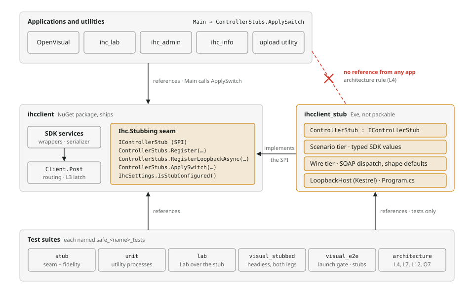

# Controller stub architecture

The controller stub stands in for an IHC controller, so tests and manual runs exercise the whole SDK without one. This page shows where the stub code lives, how one SOAP call is routed, the two ways to start a stub, and how the stub answers. It is the illustrated companion of [ADR-005](../../docs/adr/ADR-005-controller-stub-seam.md), which records the decisions, their rationale and the rejected alternatives.

Status: accepted in [ADR-005](../../docs/adr/ADR-005-controller-stub-seam.md) and implemented; this page describes the code as it is.

How to read the diagrams:

- **Amber** marks stub code or a path routed to a stub.
- **Red** marks a refusal or a forbidden reference.
- **Shaded boxes** are projects or tiers; **dashed outlines** are process boundaries.
- Tags such as `L1` or `O3` name the safeguard layers listed at the end.

## Who references whom

The SDK carries only the seam. The stub lives in its own project, which tests reference and a person can run, and which no application may reference.

The seam in `ihcclient` is the only stub-related code that ships, and `ihcclient_stub` implements its one interface. An application reaches a stub only through `--controller-stub`, which its `Main` hands to `ApplySwitch`, never by reference. `safe_architecture_tests` fails if a project outside `tests/` references `ihcclient_stub`, a test project or the FakeItEasy package, so no application carries a stub, even transitively (L4). It also fails unless the application code that touches the seam matches a fixed list, which includes each `Main` applying the switch, so a dropped call fails as surely as an extra one (O7).

## One SOAP call through Client.Post

The stub replaces the controller, not the SDK. Every call still runs the wrappers, the serializer, the envelope guards, the cookie session and telemetry. Only the transport decision changes.

The stub check runs first, ahead of the existing explicit-transport seam. It reads the client's url, which is fixed at construction, and not `settings.Endpoint`, which Lab rewrites at runtime. A stub endpoint never reaches a controller's socket, only an in-process stub or the loopback host it was registered for, and a non-stub endpoint never reaches a stub. Both stub paths return a real HTTP response, so the SDK's mapping, envelope guards, cookies and spans run as they do against a controller.

## Two ways to start a stub

A test that calls the SDK itself registers the stub in its own process. A launched executable is pointed at a stub in another process by one command-line switch.

On the left, the test owns the stub, the registration and the SDK services, and disposes the registration when it is done. On the right, the stub and its journal stay in the process that started the loopback host: a test, or `ihcclient_stub` run by hand. Once the app has loaded its settings and started its telemetry, its `Main` hands its arguments and those settings to `ApplySwitch`, so the identity check is traced. A refusal then fails the start like any other startup failure: OpenVisual and Lab log it as Critical through the pipeline, and a console utility prints it, and each exits non-zero. Before starting its telemetry, `Main` checks whether the switch is present, and a stubbed run then marks every trace, metric and log with `ihc.controller.stub=true`, so stub calls never mix into a real controller's figures. The switch replaces the endpoint and the credentials with stub values; every other setting, such as `LogSensitiveData` and the telemetry settings, still comes from the file (O5). So the developer's controller address and login never reach a stub. The stub still records no password, because a person can type one into Lab's login dialog. `ApplySwitch` checks the host's token before `Main` continues, so an app pointed at a tunnel or the wrong port refuses to start. The SDK keeps the registration and never hands it to the app, so nothing in the app can release it, and the latch refuses real endpoints until the process exits (L3). So Lab's title keeps its stub marker for the whole run, even after a person types a real endpoint into its Setup dialog.

A desktop test launches the app through one helper, which starts a fresh loopback host for every launch and always passes the switch. Once, right after launch and before the first action, it checks that the host saw the app's identity check and that the window title shows the stub marker. If either is missing, it kills the app and fails (O6). One check is enough: the registration cannot be released, and the title comes from the same check that routes calls. A utility's test runs the utility from a clean copy of its build output, with a settings file whose endpoint can only fail, so only the switch can make the utility print its stub line (O8). The desktop driver launches OpenVisual from such a copy too, whose settings keep the developer's telemetry and logging, so a desktop run still reports where it always did, and the run fails before any test unless those settings name an endpoint that can only fail and no login.

## Inside ihcclient_stub: answering one exchange

Tests write SDK model values, and the wire tier turns them into SOAP. One descriptor table, `SdkOperations`, has a row for every wire operation the SDK can post, naming its service, wire action, kind of answer and the SDK method that sends it.

Dispatch keys on the service and the wire action the SDK posts, which is the contract method name without `Async`. It never uses the WSDL `Action`, because the WSDL gives both `testSendMessage` overloads the same one. The four checks run in a fixed order and the first hit answers. An injected failure never changes the stub's state. A shape default proves that the response maps, not that the operation succeeded.

Two kinds of failure sit outside this chain. Cancellation passes through unchanged. A stub that throws or returns null is a defect: the SDK raises it as `CONTROLLER_STUB_FAULTED`, and the stub records it in `Defects`. So is an answer no final HTTP response carries, a status outside 200 to 599 or a null body: `ControllerStubResponse` refuses it when the stub builds it, which is a throw, so it fails the same way over both transports instead of reaching the caller as a controller's status.

## Which suite uses which path

| Suite | How it reaches the stub | What it covers |
|---|---|---|
| `safe_stub_tests` | In-process `Register`, and loopback `RegisterLoopbackAsync` | Routing and refusals in `Client.Post`, the latch, what the switch replaces and keeps, and stub fidelity through the real SDK: the password rule, segments and operation completeness. Also the stub host, run as a process from a clean copy. |
| `safe_unit_tests` | Loopback, through the switch of each utility it starts | The console utilities, each run as a process from a clean copy (O8). |
| `safe_lab_tests` | In-process: the suite's fixture under a `mock://` key, and each smoke case under a generated endpoint of its own | Lab smoke tests over the stub. They replace the FakeItEasy fake. |
| `safe_visual_stubbed_tests` | In-process leg and loopback leg, headless | The OpenVisual stub title and the absence of side effects. The fixture fails if an `ihcsettings.json` is present. |
| `safe_visual_e2e_tests` | Every desktop launch of a clean copy of `ihc_openvisual.exe` (O8) passes `--controller-stub` to a fresh loopback host | Desktop runs, only on request: the launch gate (O6) checks every launch once, and `DesktopOnly` scenarios cover the stub smoke, the gate's own failure and the refused starts. The headless leg runs in-process with no settings, so it needs no gate; it checks the gate's logic, that one helper is the only launch site, that only the real driver's launch verb starts a process, and the copy's settings, their check and its refresh. |
| `safe_architecture_tests` | None; reads project files and IL | No application references the stub (L4), the application code that touches the seam matches a fixed list (O7), the stub makes no outbound connection (L7), and the SDK creates network clients only at its named transport sites, while no executable the switch is wired into creates one at all (L12). |

`safe_unit_tests`, `safe_project_tests`, `safe_lab_tests`, `safe_visual_tests`, `safe_visual_stubbed_tests` and `safe_visual_e2e_tests` also each register a stub that fails every call, and hold it for the whole run. So the latch refuses a real endpoint there, even from a service no test meant to build (L11). The shared fixture is declared outside any namespace, because NUnit applies a setup fixture to the whole assembly only from there; a probe in each suite's own namespace proves the latch is on for that suite's tests. Its stub needs only `ihcclient`, so these suites take no reference to `ihcclient_stub` for it. `safe_stub_tests` is left out, because its seam tests must see the latch both off and on.

## Safeguard layers

| Tag | Safeguard | What it guarantees |
|---|---|---|
| L1 | Reserved host | A stub endpoint is `mock://` or a host under `.controllerstub.invalid`, which never resolves; behind a system proxy, the proxy refuses it instead. Either way no controller is reached, even if every other layer fails. |
| L2 | Two-way refusal | A stub endpoint goes only to the registry and fails with `CONTROLLER_STUB_NOT_REGISTERED` when nothing is registered for it. A non-stub endpoint never reaches a stub. |
| L3 | Latch | While any registration is live, the socket path refuses every endpoint with `CONTROLLER_SOCKET_REFUSED_WHILE_STUBBED`. Disposing the last registration a test made releases it; the switch's registration is never released, so a switched process stays latched until it exits. |
| L4 | No stub in an app | No project outside `tests/` may reference `ihcclient_stub`, a test project or the FakeItEasy package, so no application carries a stub, directly or through another project. |
| L5 | Fail-closed fixture | `safe_visual_stubbed_tests` fails its run, never ignores it, when an `ihcsettings.json` sits beside its assembly, because nothing in it may read a controller's settings. |
| L6 | Request destinations checked | In `safe_visual_stubbed_tests`, every request the SDK's telemetry or the runtime's own HTTP telemetry records must go to a stub host or the loopback address, and a canary call at the start must be recorded, so a capture that sees nothing cannot pass. |
| L7 | No outbound connection from the stub | An architecture test reads the stub's IL and refuses any client transport of its own: an `HttpClient` or handler, a WCF client, or a socket, WebSocket, QUIC or mail API. The loopback host still listens, through framework code. |
| L8 | Loud faults | An operation the stub does not model fails the call, a defect in the stub fails it with `CONTROLLER_STUB_FAULTED`, and the stub records both, so `VerifyNoFaults()` at teardown fails a test whose code swallowed the failure. |
| L9 | Reach guard | A suite whose own code builds real SDK services from settings, or a network transport of its own, socket and web clients included, is stopped before any of its tests executes, a filtered run included, unless each such site is admitted in `tests/shared/ControllerReachGuard.cs` with a reason that is true of it: a registered stub endpoint, a latch probe on a reserved `.invalid` host, or a service on which nothing is called. A subclass the suite declares counts as what it derives from. |
| L10 | Visible indicator | OpenVisual's and Lab's titles say stub whenever their calls go to a stub, Lab's for as long as its process is latched. |
| L11 | Latch held for the run | Each suite that links the shared latch fixture, the ones listed below the suite table, registers a stub that fails every call and holds it until the run ends, so the latch refuses every real endpoint in it. The one guarded suite without it, `safe_stub_tests`, may not stage the developer's settings file. |
| L12 | No socket outside the SDK's transport | In the SDK, only the shared HTTP client, the stub's loopback client and the telemetry self-check may create a network client, only named methods may send on one, and only the generated SOAP layer may use WCF. An executable the switch is wired into, or the bootstrap code the executables share, may not create or use one at all. |
| O1 | Loopback-only switch | `--controller-stub` accepts only `http` to `127.0.0.0/8` or `[::1]`, with an explicit port and a token path, written exactly `--controller-stub=` and its value. Anything else stops the executable from starting, a near spelling of the switch such as another case or a colon included. |
| O2 | Locked-down client | The loopback client uses no proxy, follows no redirects, keeps no cookie container and connects only to loopback addresses. |
| O3 | Identity preflight | `RegisterLoopbackAsync` checks the host's token echo before its task completes, and `ApplySwitch` before it returns, which defeats a tunnel or port-forward to a real controller. |
| O4 | Per-response stub header | Every answer from a loopback stub host must carry the host's token in exactly one header, which also catches another process taking the port after the identity check. By then the request has been sent, and the refusal says so. |
| O5 | File credentials never used | Under the switch the endpoint and the credentials are replaced by stub values, and every other setting still comes from the file. The stub never records a password. |
| O6 | Launch gate | Every desktop launch passes the switch to a fresh loopback host. Once, before the first action, the test checks that the host saw the identity check and that the title shows the stub marker, and kills the app otherwise. Only one helper asks the driver to launch, and only the real driver's launch verb starts a process: `doctor` launches only with that helper's launch flag, a bare `doctor` starts nothing, and the desktop driver refuses a launch without the switch. |
| O7 | Stub surface confined | The code in the SDK and in each application that touches the stub seam must match a fixed list, including each `Main` applying the switch, so a dropped call fails as surely as an extra one. Outside the seam, no SDK or application code may spell a stub endpoint, so the marker and the routing use one check. |
| O8 | Executables run from a clean copy | A test that starts a utility or OpenVisual starts it from a copy of its build output without the developer's settings file, using an endpoint under the reserved `.invalid` domain, so an executable that ignored the switch fails rather than passes. OpenVisual's copy keeps the developer's telemetry and logging settings and no login, and the desktop run fails before any test unless the copy's settings check. The driver checks them again before every launch. |

Which operations get typed answers: every operation seen in real controller traffic, the positive-flow operations that traffic lacks, and OpenAPI's operations over the resources, the login and the stored project, with its event wait. Every other operation gets a shape default, which ignores the scenario, so OpenAPI's other mirrors, such as its time and uptime, do not follow the typed services; a typed value is added when a test needs one.
